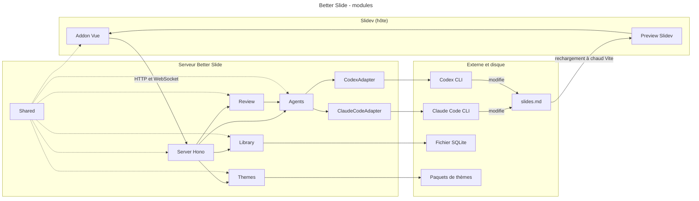

# INSTALL.md - `Better Slide (BS)`

Technical vision and installation guide.

## Vision

Revue de slides par commentaires, avec un coding agent branché sur l'abonnement de l'utilisateur, sur Slidev.

Better Slide est un outil open source et local pour les développeurs et makers qui font des présentations avec Slidev. L'utilisateur parcourt son deck, sélectionne des éléments, empile des commentaires structurés, puis envoie toute la pile à un coding agent (Claude Code, Codex) qui modifie le `slides.md`. L'agent tourne sur l'abonnement de l'utilisateur, pas sur l'API facturée. Le différenciateur est la boucle de revue visuelle et économe en tokens. Un deck reste un projet Slidev normal.

Périmètre : trois blocs de travail livrés par jalons.

1. Revue par commentaires avec l'agent (jalon 1, cœur du produit).
2. Bibliothèque de decks et historique des revues (jalon 2).
3. Thèmes et parcours guidé de création de thème (jalon 3).

Hors périmètre de la V1 : l'édition manuelle sur la slide (texte, position, taille) et l'application desktop (Electron ou Tauri, envisagée plus tard).

## Decisions

| Decision           | Choice                                                                 | Why                                                                                                      |
| ------------------ | ---------------------------------------------------------------------- | -------------------------------------------------------------------------------------------------------- |
| Architecture       | Monolithe local modulaire (monorepo de paquets, un seul processus)     | Mono-utilisateur en local. Les modules séparés laissent ouverts un emballage desktop (B ou C) plus tard. |
| Front-end          | Vue 3 + Vite, TypeScript, injecté dans le preview Slidev (couche globale) | Stack de Slidev, maîtrisée par l'équipe. Pas de SEO.                                                  |
| Back-end           | Node + TypeScript, Hono (ou Fastify) en middleware du serveur Vite de Slidev | Pas de second port. Couche d'agents en interface, un adaptateur par CLI.                            |
| Database           | Fichiers (`slides.md`, source de vérité) + SQLite local pour l'index et l'historique | Retrouver les decks et leurs revues demande de l'interroger. Local, sans serveur, sans coût. Un JSON peut suffire au début (à trancher en phase de plan). |
| Auth               | Aucune                                                                 | L'abonnement est porté par les CLI de l'utilisateur.                                                     |
| Hosting            | Aucun, distribution npm + GitHub                                       | Outil local, budget 0.                                                                                   |
| Themes             | Thèmes Slidev (paquets locaux générés par l'outil, tokens dans un fichier) | Le deck reste un projet Slidev normal, utilisable sans Better Slide.                                |

## Stack summary

- **Front-end:** Vue 3 + Vite + TypeScript, addon Slidev (`global-top.vue`, composants). Versions à figer au scaffolding.
- **Back-end:** Node + TypeScript, Hono (ou Fastify), en middleware via `configureServer` d'un plugin Vite.
- **Database:** fichiers + SQLite local, dans le dossier de config de l'utilisateur. Les decks restent dans leurs dossiers de projet.
- **Auth:** aucune.
- **Hosting:** aucun (npm + GitHub).
- **Key integrations:** CLI Claude Code et Codex (lancées en local, en mode headless, via l'abonnement). Slidev (addons, plugins Vite, thèmes).

## Architecture



L'addon Vue vit dans le preview Slidev et parle au serveur, qui est un middleware du serveur Vite de Slidev. Le serveur délègue : `review` construit le prompt à partir de la pile de commentaires structurés, `agents` pilote les CLI de l'utilisateur, `library` tient l'index et l'historique, `themes` génère les paquets de thèmes. Les agents modifient directement le `slides.md`, et le rechargement à chaud de Vite met à jour le preview. La frontière est la couche `agents` : seuls ses adaptateurs connaissent les CLI.

## Folder structure

```
better-slide/
├── package.json
├── tsconfig.json
├── README.md
├── aidd_docs/
│   └── INSTALL.md
├── packages/
│   ├── addon/            # addon Slidev : setup/, global-top.vue, composants
│   │   ├── components/   # sélection, pile de commentaires, wizard thèmes, bibliothèque
│   │   └── setup/        # vite-plugins.ts (branche le serveur)
│   ├── server/           # Hono : routes commentaires, bibliothèque, thèmes
│   ├── review/           # schéma des commentaires + prompt builder
│   ├── agents/           # interface Agent + adapters/claude-code, adapters/codex
│   ├── library/          # accès SQLite : decks, revues
│   ├── themes/           # génération de paquets de thèmes Slidev
│   └── shared/           # types et schémas
└── examples/
    └── demo-deck/        # deck Slidev de démonstration
```

## Install steps

Manual install - the framework does not yet scaffold these automatically.

1. Installer Node (version récente supportée par Slidev et Vite) et un gestionnaire de paquets (pnpm recommandé pour un monorepo).
2. Installer et connecter les CLI de l'utilisateur : Claude Code, et Codex si utilisé (connexion avec l'abonnement).
3. Initialiser le dépôt git et le monorepo (workspaces) avec la structure de `packages/` ci-dessus.
4. Créer `examples/demo-deck` avec Slidev, et vérifier que `slidev` démarre.
5. Faire en premier le spike : un addon minimal (couche globale + hook Vite répondant sur une route) pour valider la combinaison, puis le lien élément du rendu → source (repli : numéro de slide + extrait de texte + sélecteur).
6. Vérifier le lancement headless de chaque CLI depuis un processus Node, avec `ANTHROPIC_API_KEY` et `OPENAI_API_KEY` retirés de l'environnement, et un PATH résolu via un shell de login.
7. Relire les conditions d'utilisation d'Anthropic et d'OpenAI sur l'usage des abonnements par un outil tiers avant toute publication.

## Audit summary

Results of the multi-agent audit run during action 03:

| Candidate                    | Verdict | Notes                                                                                                                       |
| ---------------------------- | ------- | --------------------------------------------------------------------------------------------------------------------------- |
| A. Plugin Slidev + CLI       | ⚠️      | **Retenu.** Intégration propre, mais lien rendu → source non confirmé (spike requis) et conditions d'utilisation des CLI à vérifier. |
| B. Electron                  | ⚠️      | Faisable, mais Slidev doit tourner dans un processus séparé. Signature macOS (99 $/an), binaire lourd, PATH des CLI à résoudre. |
| C. Tauri + sidecar Node      | ⚠️      | Faisable, mais il faut embarquer un runtime Node, un peu de Rust, webviews inégales (Linux). Audit sans recherche en ligne.  |

Risques communs : conditions d'utilisation des abonnements (zone grise, sources contradictoires, non vérifiées), et lien rendu → source indépendant du packaging.
