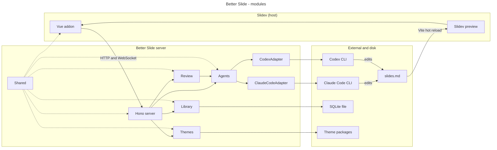

# INSTALL.md - `Better Slide (BS)`

Technical vision and installation guide.

## Vision

Comment-based slide review with a coding agent that runs on the user's own subscription, built on Slidev.

Better Slide is an open source, local tool for developers and makers who build presentations with Slidev. The user browses the deck, selects elements, stacks structured comments, then sends the whole stack to a coding agent (Claude Code, Codex) that edits `slides.md`. The agent runs on the user's subscription, not on the billed API. The differentiator is a visual, token-efficient review loop. A deck stays a regular Slidev project.

Scope: three work blocks, delivered as milestones.

1. Comment-based review with the agent (milestone 1, the core of the product).
2. Deck library and review history (milestone 2).
3. Themes and a guided theme-creation flow (milestone 3).

Out of scope for V1: manual editing on the slide (text, position, size) and a desktop app (Electron or Tauri, considered later).

## Decisions

| Decision     | Choice                                                                              | Why                                                                                                             |
| ------------ | ----------------------------------------------------------------------------------- | --------------------------------------------------------------------------------------------------------------- |
| Architecture | Modular local monolith (monorepo of packages, a single process)                     | Single user, local. Separate modules keep a later desktop packaging (Electron or Tauri) open.                   |
| Front-end    | Vue 3 + Vite, TypeScript, injected into the Slidev preview (global layer)           | Slidev's own stack, mastered by the team. No SEO.                                                               |
| Back-end     | Node + TypeScript, Hono (or Fastify), as middleware of Slidev's Vite dev server     | No second port. The agent layer is an interface with one adapter per CLI.                                       |
| Database     | Files (`slides.md`, source of truth) + local SQLite for the index and history       | Finding decks and their reviews requires queries. Local, serverless, free. A JSON file may be enough at first (to settle in the plan phase). |
| Auth         | None                                                                                | The subscription is carried by the user's own CLIs.                                                             |
| Hosting      | None, distributed via npm + GitHub                                                  | Local tool, zero budget.                                                                                        |
| Themes       | Slidev themes (local packages generated by the tool, tokens kept in a file)         | The deck stays a regular Slidev project, usable without Better Slide.                                           |

## Stack summary

- **Front-end:** Vue 3 + Vite + TypeScript, Slidev addon (`global-top.vue`, components). Versions to pin at scaffolding time.
- **Back-end:** Node + TypeScript, Hono (or Fastify), mounted through `configureServer` of a Vite plugin.
- **Database:** files + local SQLite, in the user's config directory. Decks stay in their own project folders.
- **Auth:** none.
- **Hosting:** none (npm + GitHub).
- **Key integrations:** Claude Code and Codex CLIs (launched locally in headless mode, on the user's subscription). Slidev (addons, Vite plugins, themes).

## Architecture



The Vue addon lives in the Slidev preview and talks to the server, which is middleware of Slidev's Vite server. The server delegates: `review` builds the prompt from the stack of structured comments, `agents` drives the user's CLIs, `library` keeps the index and history, `themes` generates the theme packages. Agents edit `slides.md` directly, and Vite hot reload updates the preview. The boundary is the `agents` layer: only its adapters know about the CLIs.

## Folder structure

```
better-slide/
├── package.json
├── tsconfig.json
├── README.md
├── aidd_docs/
│   └── INSTALL.md
├── packages/
│   ├── addon/            # Slidev addon: setup/, global-top.vue, components
│   │   ├── components/   # selection, comment stack, theme wizard, library
│   │   └── setup/        # vite-plugins.ts (mounts the server)
│   ├── server/           # Hono: comments, library and themes routes
│   ├── review/           # comment schema + prompt builder
│   ├── agents/           # Agent interface + adapters/claude-code, adapters/codex
│   ├── library/          # SQLite access: decks, reviews
│   ├── themes/           # Slidev theme package generation
│   └── shared/           # types and schemas
└── examples/
    └── demo-deck/        # demo Slidev deck
```

## Install steps

Manual install - the framework does not yet scaffold these automatically.

1. Install Node (a recent version supported by Slidev and Vite) and a package manager (pnpm recommended for a monorepo).
2. Install and log in the user-side CLIs: Claude Code, and Codex if used (sign in with the subscription).
3. Initialize the git repository and the monorepo (workspaces) with the `packages/` structure above.
4. Create `examples/demo-deck` with Slidev, and check that `slidev` starts.
5. Do the spike first: a minimal addon (global layer + a Vite hook answering on one route) to validate the combination, then the rendered element → source link (fallback: slide number + text excerpt + selector).
6. Check that each CLI launches headless from a Node process, with `ANTHROPIC_API_KEY` and `OPENAI_API_KEY` removed from the environment, and a PATH resolved through a login shell.
7. Re-read Anthropic's and OpenAI's terms of use on subscription use by third-party tools before any release.

## Audit summary

Results of the multi-agent audit run during action 03:

| Candidate               | Verdict | Notes                                                                                                                              |
| ----------------------- | ------- | ---------------------------------------------------------------------------------------------------------------------------------- |
| A. Slidev plugin + CLI  | ⚠️      | **Chosen.** Clean integration, but the rendered element → source link is unconfirmed (spike required) and CLI terms of use must be checked. |
| B. Electron             | ⚠️      | Feasible, but Slidev must run in a separate process. macOS signing ($99/yr), heavy binary, CLI PATH to resolve.                    |
| C. Tauri + Node sidecar | ⚠️      | Feasible, but a Node runtime must be bundled, some Rust is needed, webviews are uneven (Linux). Audit ran without online search.   |

Shared risks: subscription terms of use (gray area, conflicting sources, unverified), and the rendered element → source link, which is independent of packaging.
