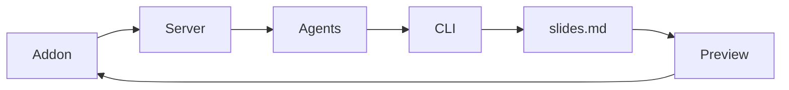

# Architecture

## Stack

- TypeScript on Node with Vue 3 and Vite, because Slidev is built on them.
- Hono (or Fastify) serves the API as middleware of Slidev's Vite dev server, so no second port is needed.
- pnpm manages the workspace.

## Decisions

- Better Slide is a Slidev addon, so a deck stays a regular Slidev project.
- Agents run through the user's installed CLI on their subscription, so Better Slide holds no account and no billing.
- Decks stay in their own project folders. A local SQLite file only indexes them and their review history.
- The modular local monolith keeps a later desktop packaging possible without a rewrite.
- Module layout and the audit behind these choices: `aidd_docs/INSTALL.md`.

## Constraints

- Only the agent adapters know the AI CLIs.
- Remove `ANTHROPIC_API_KEY` and `OPENAI_API_KEY` from the CLI environment, or the CLI bills the API instead of the subscription.
- Never read, copy or store CLI credentials.

## Gotchas

- An app launched from a GUI does not inherit the shell `PATH`, so resolve `claude` and `codex` through a login shell.
- Mapping a rendered element to its line in `slides.md` is unproven. Fall back to slide number, text excerpt and selector.

## Flow

